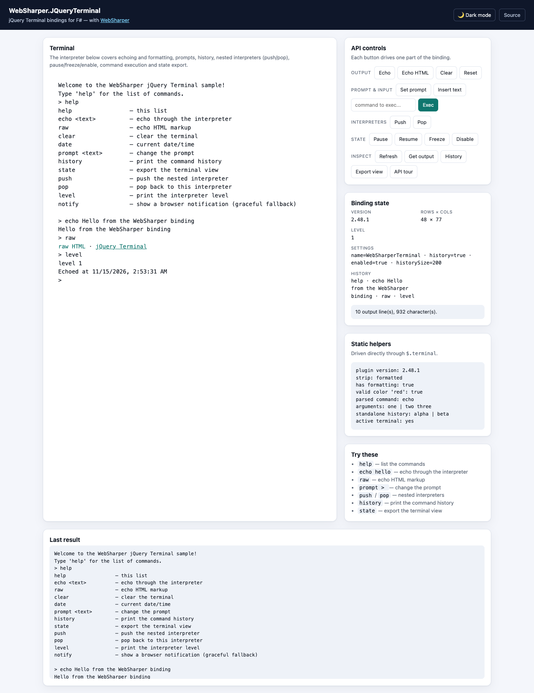

# WebSharper.JQueryTerminal

[](https://www.nuget.org/packages/WebSharper.JQueryTerminal)

WebSharper bindings for [jQuery Terminal](https://terminal.jcubic.pl/) 2.48 —
command-line interpreters, echo/formatting, prompts, history, nested
interpreters, authentication, animations and the `$.terminal` helper API, from
F# and C# web apps.

The binding consumes the npm package
[`jquery.terminal`](https://www.npmjs.com/package/jquery.terminal) (the UMD
plugin factory) and the [`jquery`](https://www.npmjs.com/package/jquery) that
[`WebSharper.JQuery`](https://github.com/dotnet-websharper/jquery) imports.
There is no CDN `<script>`: your bundler (esbuild in the sample) bundles one
copy of jQuery, the plugin installs itself on that instance, and every
`JQuery.Of(...)`/terminals call shares it.

> **Release line:** this branch targets **WebSharper 11** and **.NET 11+**. A
> `websharper100` branch with the same surface targets WebSharper 10.

This repository contains:

| Project | Purpose |
| --- | --- |
| `WebSharper.JQueryTerminal` | The binding: `Terminal`, `Cmd`, `TerminalHistory`, the option/config shapes and the `$.terminal` static helpers. |
| `WebSharper.JQueryTerminal.Sample` | A WebSharper SPA (esbuild → `dist/`) that drives the whole bound surface with a light/dark theme switcher. |

## Live demos

**Try it live:** [Open the sample in your browser](https://dotnet-websharper.github.io/JQuery.Terminal/)



The sample doubles as the binding's [test case](#running-the-test-case): it
creates a terminal with an interpreter, and drives echoing/formatting, prompts,
insert/exec, history, nested interpreters (push/pop), pause/resume,
freeze/enable, state export, `get_output` and the `$.terminal` static helpers.

- **Sample (this repository):** <https://dotnet-websharper.github.io/JQuery.Terminal/>
- **Source repository:** <https://github.com/dotnet-websharper/JQuery.Terminal>
- **WebSharper bindings:** <https://websharper.com/bindings>

## Features

- `Terminal`: construct from a selector or element; `Echo`/`EchoHtml`/`Error`,
  `Clear`, `Reset`, `Exec`, `Push`/`Pop`, `Pause`/`Resume`, `Freeze`,
  `Enable`/`Disable`, `Focus`/`Blur`, `SetPrompt`/`GetPrompt`, `Insert`,
  `Enter`, `Read`, `Typing`, `Complete`, `Settings`, `Geometry`, `History`,
  `ExportView`/`ImportView`, `SaveState`, `GetOutput`, `Update`, `RemoveLine`,
  `Flush`, `Refresh`, `Resize`, `Token`/`SetToken`, `Login`/`Logout`,
  `Option`, `Keymap`, `InvokeKey`, `Purge`, `Destroy`.
- `Cmd`: the command-line object, with `Option`, `Name`, `History`, `Delete`,
  `Set`, `Insert`, `Keymap`, `Commands`, `Prompt`, `Position`,
  `DisplayPosition`, `KillText`, `Refresh`, `Enable`/`Disable`, `Mask`,
  `ClearCache`, `Destroy`.
- `TerminalHistory`: `Append`, `Set`, `Data`, `Current`, `Next`, `Previous`,
  `Position`, `Last`, `End`, `Enable`/`Disable`, `Clear`, `Purge`, `Toggle`.
- Option shapes: `TerminalOptions`, `PushOptions`, `EchoOptions`,
  `InsertOptions`, `ReadOptions`, `CompleteOptions`, `ExecOptions`,
  `FormatOptions`, `TerminalView`, `TerminalLine`, `InterpreterItem`,
  `ParsedCommand`, `TerminalGeometry`, `TerminalPadding`, `RenderHandlerOptions`
  and the interpreter/keymap maps.
- `$.terminal` helpers: `PluginVersion`, `Format`, `Strip`, `Length`,
  `EscapeBrackets`, `UnescapeBrackets`, `EscapeFormatting`, `HaveFormatting`,
  `IsFormatting`, `FormatSplit`, `Normalize`, `SplitEqual`, `Columns`, `Amp`,
  `Encode`, `ValidColor`, `UnclosedStrings`, `EscapeRegex`, `ParseArgument`,
  `ParseArguments`, `SplitArguments`, `ParseCommand`, `SplitCommand`,
  `ParseOptions`, `ParseFormatting`, `IterateFormatting`, `Active`, `LastId`,
  `ColorNames`, `CreateHistory`.

All callbacks are typed (`ThisFunc`/`FuncWithThis`/`Func`/`Action` and their
tuple forms), promises are returned as `WebSharper.JQuery.Promise`, and DOM
arguments reuse `WebSharper.JavaScript.Dom` and `WebSharper.JQuery` types.

## One bundled jQuery instance

The binding imports the plugin factory from npm:

```fsharp
// Package import, emitted once:
//   import JQueryTerminal from "jquery.terminal"
// The factory installs `$.fn.terminal` on the jQuery instance and returns it.
```

The first terminal (or static helper) calls the factory with `window`; the
factory resolves jQuery from the same npm package that `WebSharper.JQuery`
imports, and the binding caches the result on `globalThis.__wsJQueryTerminal`.
That means:

- no global `jQuery` script tag is needed,
- the terminal instance and `JQuery.Of(...)` use the same jQuery object,
- the plugin is installed exactly once.

`WebSharper.JQuery` targets jQuery **4.0**, while jQuery Terminal 2.48 still
declares `jquery@^3.7.1` as its npm dependency. jQuery Terminal 2.48 runs on
jQuery 4 (the sample exercises it), but npm installs a nested 3.7 copy unless
you force one version. That nested copy is a second jQuery instance — the
classic "plugin is not a function" failure.

Pin jQuery 4 and add an npm `overrides` entry so both packages resolve to the
same copy:

```json
{
  "dependencies": {
    "jquery": "^4.0.0",
    "jquery.terminal": "^2.48.1"
  },
  "overrides": {
    "jquery.terminal": {
      "jquery": "$jquery"
    }
  }
}
```

```bash
npm install
```

Check it with `npm ls jquery --all`: it must show a single, deduped version. The
sample's `package.json` uses exactly this setup. If you deliberately stay on
jQuery 3.7, make sure jQuery 4 is not installed either; one copy is the rule.

## Install

```bash
dotnet add package WebSharper.JQueryTerminal
```

Or with Paket:

```fsharp
nuget WebSharper.JQueryTerminal
```

The package targets `netstandard2.0` and depends on `WebSharper.JQuery`. It
declares the npm dependency
`jquery.terminal >= 2.48.1 < 3.0.0` (inclusive lower bound, next major
exclusive).

## Usage

```fsharp
namespace WebSharper.JQueryTerminal.Demo

open WebSharper
open WebSharper.JavaScript
open WebSharper.JQueryTerminal

[<JavaScript>]
module Demo =

    // `ThisFunc` is the (this, command, term) => ... shape used by jQuery
    // Terminal. Returning null means "no value to echo".
    let interpreter =
        ThisFunc<Terminal, string, Terminal, obj>(fun (this: Terminal) command term ->
            match command.Trim() with
            | "help" ->
                this.Echo("Commands: help, clear, date") |> ignore
                null
            | "clear" ->
                this.Clear() |> ignore
                null
            | "date" ->
                this.Echo(string (System.DateTime.Now)) |> ignore
                null
            | "" -> null
            | unknown ->
                term.Error("Unknown command: " + unknown) |> ignore
                null
        )

    let createTerminal () =
        let options = TerminalOptions()
        options.Name <- "demo"
        options.Prompt <- Union2Of2 "> "
        options.Greetings <- Union2Of2 "Welcome! Type 'help'."
        options.History <- true
        options.HistorySize <- 200
        options.OnInit <-
            ThisFunc<Terminal, Terminal, bool>(fun (this: Terminal) _ ->
                this.Enable() |> ignore
                true)

        let terminal = Terminal("#terminal", interpreter, options)

        // Static helpers are called on the same installed plugin.
        Console.Log("jQuery Terminal", Terminal.PluginVersion)
        let parsed = Terminal.ParseCommand("echo hello world")
        Console.Log("parsed:", parsed.Name, Terminal.SplitArguments("echo hello world"))

        // A standalone history object.
        let history = Terminal.CreateHistory("demo", 50, false)
        history.Append("first")
        Console.Log("history:", history.Data())

        terminal
```

`Prompt`, `Greetings`, `Login` and a few other option fields are WIG unions
(string vs callback), so assign them with the union case — `Union2Of2` for the
string alternative in most cases (the exact case numbers follow the
declaration order in `Main.fs`; IntelliSense shows the generated type).

Nested interpreters work the same way:

```fsharp
let nested =
    ThisFunc<Terminal, string, Terminal, obj>(fun (this: Terminal) command _ ->
        match command.Trim() with
        | "pop" -> this.Pop() |> ignore; null
        | _ ->
            this.Echo("nested> type 'pop' to return") |> ignore
            null)

let options = PushOptions()
options.Name <- "nested"
options.Prompt <- Union2Of2 "nested> "
terminal.Push(nested, options) |> ignore
```

## Running the test case

The sample is a static SPA. Building it runs `npm install` and esbuild and emits
`dist/` at the repository root:

```bash
dotnet build WebSharper.JQueryTerminal.Sample/WebSharper.JQueryTerminal.Sample.fsproj -c Release
```

Serve it with [dotnet-serve](https://github.com/dotnet-serve/dotnet-serve):

```bash
dotnet tool install -g dotnet-serve   # once
dotnet serve -d dist -p 8080
```

Then open <http://localhost:8080/>. The sample's interpreter and toolbar cover
the binding's surface: `help`, `echo`, `raw`, `date`, `prompt`, `history`,
`state`, `push`/`pop` and `level`; the right-hand controls call `Echo`,
`EchoHtml`, `Clear`, `Reset`, `SetPrompt`, `Insert`, `Exec`, `Push`, `Pop`,
`Pause`, `Resume`, `Freeze`, `Disable`, `Refresh`, `GetOutput`, `History` and
`ExportView`, and the state card reports `Version`, `Geometry`, `Level`,
`Settings`, the command history and the static helpers.

## Build from source

Prerequisites: .NET 11 SDK, Node.js (for the sample) and Paket (restored as a
local tool).

```bash
dotnet tool restore
dotnet paket install
dotnet build WebSharper.JQueryTerminal/WebSharper.JQueryTerminal.fsproj -c Release
dotnet build WebSharper.JQueryTerminal.Sample/WebSharper.JQueryTerminal.Sample.fsproj -c Release
```

The build stack entry point is `./build <target>` (`CI-Release`, `WS-Package`,
…), and `WSPackageFolder=/tmp/pkg ./build WS-Package` produces the NuGet
package.

## Deployment

`./.github/workflows/ghpages.yml` builds the sample in Release on .NET 11 and
publishes `dist/` to the `gh-pages` branch with
[`peaceiris/actions-gh-pages`](https://github.com/peaceiris/actions-gh-pages).
It runs only for pushes to the default branch (and manually via
`workflow_dispatch`).

## Repository layout

```
WebSharper.JQueryTerminal/          the binding (WIG definitions)
  Main.fs
  WebSharper.JQueryTerminal.fsproj
  wsconfig.json
WebSharper.JQueryTerminal.Sample/   the SPA test case
  Client.fs
  index.html
  css/index.css
  entry.mjs                         npm CSS + generated bundle
  esbuild.config.mjs                esbuild → ../dist
  package.json
  wsconfig.json
docs/sample.png                     real browser capture (light theme)
nuget/                              Paket pack template
build.fsx / build.cmd / build.sh    build-stack entry points
```

## License

Apache 2.0 — see [LICENSE.md](LICENSE.md).